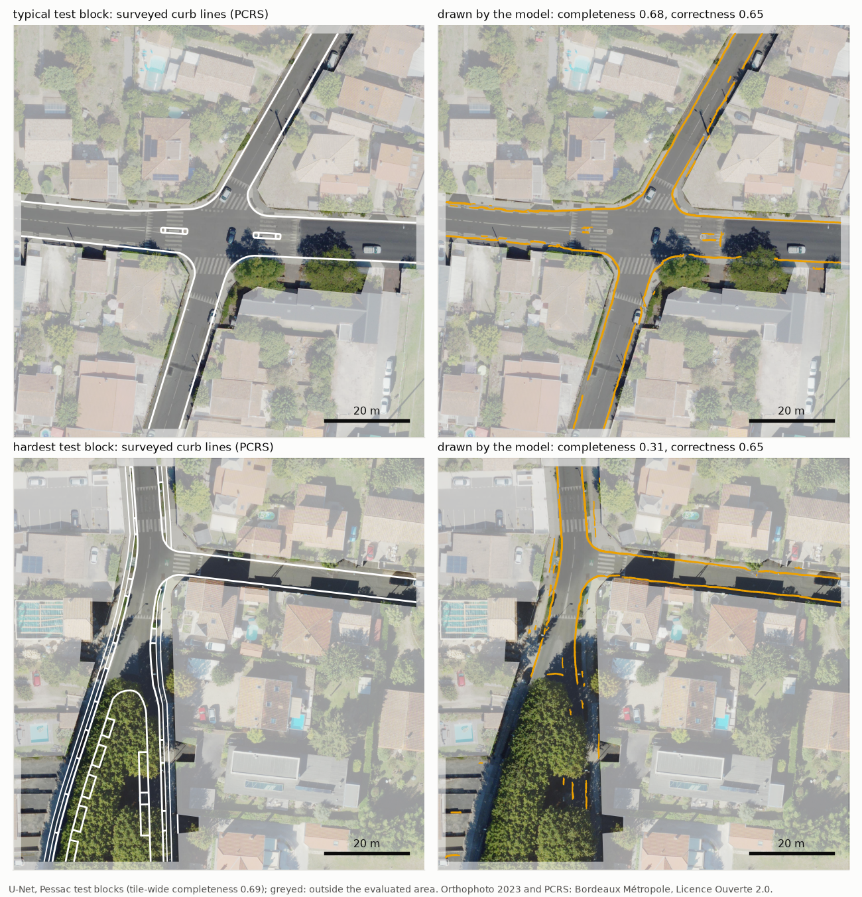
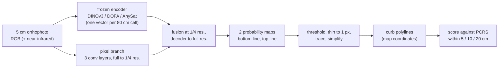
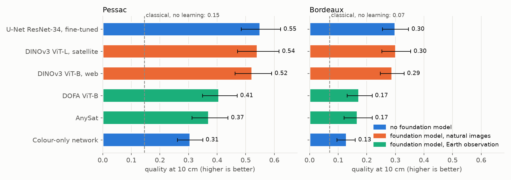
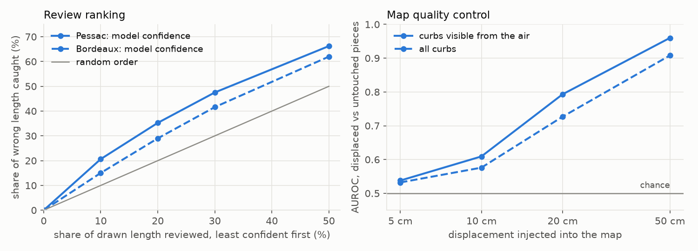

# Curb mapping with foundation models

This project measures how much of a legal street map can be drawn automatically from 5 cm aerial photos, how accurate
the drawn lines are, and whether the same model can check an existing map for errors. It uses open data from
Bordeaux, France, and one map layer, the curbs, scored at the legal tolerance of 10 cm. Frozen foundation models
(DINOv3, DOFA, AnySat) are compared with a fine-tuned U-Net and with the same small network on colour alone, under one
evaluation protocol.

## Summary

All numbers are on test areas the models never saw, at 10 cm tolerance.

- About a quarter of the surveyed curb length cannot be seen from the air because trees and parked cars cover it:
  21 % in Pessac and 27 % in Bordeaux centre. No aerial method can draw these parts.
- The best models find 69 % of the curb length in Pessac and 42 % in Bordeaux centre. Of what they draw, 71 % and 48 %
  is correct. A classical line detector finds 29 % in Pessac, with 20 % correct.
- A frozen DINOv3 encoder with a small trained head (0.5 M parameters) is as accurate as a U-Net fine-tuned end to end
  (23.7 M parameters). With the same head, DINOv3 features almost double the quality obtained from colour alone.
- DOFA and AnySat are Earth-observation foundation models pretrained on coarser imagery. At 5 cm they do better than
  colour alone but clearly worse than DINOv3.
- Most remaining errors are lines drawn a few centimetres off, on a curb stone only 15 cm wide. In the dense centre,
  parked cars and road paint also produce false lines.
- As a map checker, the model detects curb lines displaced by 50 cm (AUROC 0.96) but not by 10 cm (0.61).



*Two test blocks in Pessac, U-Net. Top: the block whose completeness is closest to the tile average. Bottom: the
hardest block, where most misses are under trees. Greyed: outside the evaluated area.*

## 1. Problem

Every French municipality has to maintain a PCRS (*Plan de Corps de Rue Simplifié*). It is a vector map of street
features such as curbs, façades, steps and manhole covers, with a required accuracy of 10 cm. Contractors working near
buried networks must use it, so it has legal weight. Surveying companies produce and update it, and a large part of
the drawing is still done by hand from aerial imagery and point clouds. Many maps are also out of date: Bordeaux
Métropole lists 852 of its PCRS zones as needing a new acquisition.

Curbs are the densest PCRS layer and the hardest one for precision. A curb stone is about 15 cm wide, which is 3 pixels
at 5 cm, and the 10 cm tolerance is 2 pixels. Each curb is surveyed as two lines, the bottom edge (gutter side) and the
top edge of the stone.

## 2. Objectives

The aim is to find out what part of the PCRS curb layer can be produced or checked automatically from aerial
imagery, and with which kind of model. This breaks down into seven questions:

| # | question | why it matters |
|---|---|---|
| 1 | Is the open data accurate enough to measure 10 cm, and how much of the curb is visible from the air? | Without this the scores mean nothing, and hidden curbs set an upper limit for any model. |
| 2 | How far does a method without learning get? | Reference that a learned model has to beat. |
| 3 | Do frozen foundation models help, compared with the same small network on colour alone and with a fine-tuned U-Net? | Main comparison. |
| 4 | What are the remaining errors? | Shows what would improve the result. |
| 5 | Can a confidence score per drawn line tell a drafter which lines to check first, and why a line may be wrong? | Turns the model into a review tool. |
| 6 | Can the model find lines of an existing map that are displaced or missing? | Map updating and quality control. |
| 7 | What do the trained models rely on? | Explains the differences between models. |

## 3. Data

All layers are open data from Bordeaux Métropole (Licence Ouverte 2.0), plus the IGN BD TOPO road centrelines.

| layer | resolution / accuracy | use |
|---|---|---|
| orthophoto 2023, RGB | 5 cm | model input |
| orthophoto 2023, colour infrared | 5 cm | vegetation index (NDVI); near-infrared band for the Earth-observation models |
| surface and terrain models 2023 | 50 cm | height above ground (cars, trees) |
| PCRS vectors | 3 cm (survey) | ground truth: curb lines with sub-classes |
| PCRS zone status | per delivery zone | real test case for quality control |

Two tiles of 1 km × 1.4 km are used: Pessac centre (residential, open streets, 92 km of surveyed curb) and Bordeaux
centre (dense and narrow streets, shadows, parked cars, 122 km). `scripts/download_data.py` downloads everything; no
data is stored in this repository.

## 4. Method



- **Labels.** Each PCRS line is rasterised as a 10 cm wide band (±5 cm) in its own channel, one for bottom lines and
  one for top lines. A ring from 5 to 10 cm around each line is ignored in the loss because the exact edge is
  uncertain at that scale. With a single merged channel the network drew one line between the two edges, about 7 cm
  from both; using two channels fixed this.
- **Models.** All models use the same labels, augmentation (flips and 90° rotations), loss (masked binary
  cross-entropy + Dice), 6000 iterations with batch size 8, and the same threshold selection. Shorter runs of 2000
  iterations were not converged for the frozen-encoder models and gave a different ranking, so only the 6000-iteration
  runs are compared.

  | model | encoder | trained parameters | why it is in the comparison |
  |---|---|---|---|
  | colour-only network | none (pixel branch and decoder above) | 0.23 M | same head without encoder features, so any gain of the other head models comes from the encoder |
  | DINOv3 ViT-L, satellite | frozen, pretrained by Meta on Maxar satellite images | 0.47 M | strongest general-purpose self-supervised encoder available, in its satellite-pretrained version |
  | DINOv3 ViT-B, web | frozen, pretrained on web photos | 0.44 M | same family with web pretraining and a smaller size, to separate the effect of the pretraining domain |
  | DOFA ViT-B | frozen, Earth-observation model for any spectral bands (finest pretraining data 1 m) | 0.44 M | multispectral EO foundation model that can use the near-infrared band |
  | AnySat | frozen, Earth-observation model trained on French 20 cm aerial RGB + near-infrared | 0.54 M | EO foundation model whose pretraining data is closest to this data (French aerial imagery) |
  | U-Net ResNet-34 | ImageNet-pretrained, fine-tuned end to end | 23.7 M | standard supervised segmentation network, the usual choice in production |

  The foundation models are kept frozen and only a small head is trained. This shows how much the pretrained features
  are worth by themselves, and it is how such a model would be reused cheaply for a new layer or a new city.

- **Vectorisation.** Probability above the threshold, then skeleton, then chains between end points and junctions,
  then map coordinates, Douglas–Peucker simplification, and removal of pieces shorter than 0.5 m.
- **Classical baseline.** LSD line segments on brightness, filtered by length, contrast, vegetation and height, with
  thresholds tuned on the validation area.

## 5. Evaluation protocol

- **Spatial split.** Each tile is cut into 100 m blocks, and each block is assigned to training, validation or test by
  a fixed hash. Neighbouring pixels are strongly correlated, so a random pixel split would leak information.
- **Evaluated area.** Test blocks shrunk by 2 m, inside the zones that the city declares complete, without the zones
  that the data audit found misaligned with the imagery. Outside the PCRS coverage (private gardens, courtyards) a
  drawn line cannot be judged, so it is not counted.
- **Metrics** on line length, as usual in road extraction:
  - *completeness*: share of the surveyed curb length that has a drawn line within the tolerance;
  - *correctness*: share of the drawn length that has a surveyed line within the tolerance;
  - *quality*: matched / (surveyed + drawn − matched), one number that penalises both misses and false lines.

  Matching is done point to point every 2 cm, with directions within 30°, at tolerances of 5, 10 and 20 cm.
- **Threshold.** The probability threshold is chosen on the validation blocks (quality at 10 cm) from one grid shared
  by all models, then applied once to the test blocks.
- **Confidence intervals.** 95 % intervals from a block bootstrap (test blocks resampled 1000 times). Differences
  between models are computed on the same resamples (paired). DINOv3-sat and the U-Net were each trained with a second
  seed.
- The test areas contain 18.7 km of surveyed curb in Pessac and 16.2 km in Bordeaux centre.

## 6. Results

### 6.1 Data quality and visibility

| | Pessac | Bordeaux centre |
|---|---|---|
| orthophoto to PCRS offset on visible curbs (east, north) | 0.2, 1.8 cm | 0.9, 2.5 cm |
| error when recovering an injected 15 cm / 10 cm shift | < 1 cm | < 1 cm |
| curb length visible from the air | 79 % | 73 % |
| hidden by vegetation / by cars and other objects | 12.6 % / 8.7 % | 9.3 % / 17.9 % |
| visible but in shadow | 6.2 % | 17.8 % |

The imagery and the map agree to about 2 cm, so a 10 cm tolerance can be measured. The orthophoto world files were
half a pixel off and are corrected when loading. Three delivery zones in Bordeaux centre are 43–51 cm off the imagery:
the city lists one of them as being re-acquired and the other two as complete. Two more zones give unstable offset
estimates. These five zones are excluded from the evaluation area and used later as real cases for quality control
(section 6.5).

### 6.2 Main comparison



*Quality at 10 cm on the test blocks with 95 % block-bootstrap intervals. Dashed line: classical baseline.*

| model | Pessac: completeness / correctness | Pessac: quality [95 % CI] | Bordeaux centre: completeness / correctness | Bordeaux centre: quality [95 % CI] | difference in quality to DINOv3-sat, Pessac / Bordeaux [95 % CI] |
|---|---|---|---|---|---|
| U-Net ResNet-34, fine-tuned | 0.69 / 0.71 | 0.55 [0.48, 0.62] | 0.42 / 0.48 | 0.30 [0.26, 0.35] | +0.01 [−0.01, +0.03] / −0.00 [−0.02, +0.02] |
| DINOv3 ViT-L, satellite (frozen) | 0.68 / 0.71 | 0.54 [0.47, 0.62] | 0.41 / 0.50 | 0.30 [0.25, 0.35] | reference |
| DINOv3 ViT-B, web (frozen) | 0.66 / 0.69 | 0.52 [0.46, 0.59] | 0.39 / 0.48 | 0.29 [0.25, 0.33] | −0.02 [−0.04, +0.00] / −0.01 [−0.03, +0.00] |
| DOFA ViT-B (frozen) | 0.56 / 0.57 | 0.41 [0.35, 0.47] | 0.24 / 0.35 | 0.17 [0.13, 0.22] | −0.13 [−0.16, −0.11] / −0.13 [−0.15, −0.11] |
| AnySat (frozen) | 0.50 / 0.56 | 0.37 [0.31, 0.44] | 0.23 / 0.36 | 0.17 [0.12, 0.22] | −0.17 [−0.20, −0.15] / −0.13 [−0.16, −0.11] |
| colour-only network | 0.48 / 0.42 | 0.31 [0.26, 0.35] | 0.20 / 0.27 | 0.13 [0.10, 0.16] | −0.24 [−0.27, −0.20] / −0.17 [−0.20, −0.14] |
| classical line detector | 0.29 / 0.20 | 0.15 | 0.14 / 0.12 | 0.07 | |

*35 test blocks in Pessac, 25 in Bordeaux centre. The last column is the paired bootstrap difference.*

- DINOv3 and the U-Net cannot be separated: the difference is at most 0.01 and the interval contains zero in both
  areas. The second seeds give the same result (DINOv3 0.539 / 0.297, U-Net 0.545 / 0.298). DINOv3 trains 50 times
  fewer parameters, but its 300 M-parameter encoder still has to run at prediction time.
- With the same head, DINOv3 features raise quality from 0.31 to 0.54 in Pessac and from 0.13 to 0.30 in Bordeaux
  centre.
- The satellite-pretrained ViT-L is only 0.01–0.02 better than the web-pretrained ViT-B, and the interval includes zero.
  At this resolution, the pretraining domain and model size change little.
- DOFA and AnySat are better than colour alone (+0.07 to +0.10 in Pessac, +0.04 in Bordeaux) but 0.13 to 0.17 below
  DINOv3. Their finest pretraining imagery is 1 m (DOFA) and 20 cm (AnySat), so at 5 cm a curb is a detail inside one
  of their patches.
- At 5 cm tolerance the best quality drops to 0.32 (Pessac) and 0.16 (Bordeaux). At 20 cm it rises to 0.66 and 0.41.
  The difference between tolerances is mostly position error, not missing curbs (section 6.3).
- On curbs that are visible from the air, DINOv3 and the U-Net find 75 % (Pessac) and 54 % (Bordeaux centre) of the
  length.

### 6.3 Remaining errors (U-Net, test blocks)

| share of drawn length | Pessac | Bordeaux centre |
|---|---|---|
| within 10 cm of the right line type | 71 % | 47 % |
| right line type, 10–20 cm away | 9 % | 15 % |
| on the other edge of the same curb | 8 % | 9 % |
| on another PCRS object | 4 % | 8 % |
| far from any PCRS line | 8 % | 22 % |

- The model finds both edges of a curb: 95 % (Pessac) and 89 % (Bordeaux) of the drawn bottom lines have a parallel
  partner 8–35 cm away.
- The signed offsets of drawn points from their surveyed line have no bias (median below 1 cm). The interquartile
  range is about ±5 cm in Pessac and ±7 cm in Bordeaux.
- Two corrections were tested and did not help. Relabelling each pair by road side (the line closer to the IGN road
  centreline is the bottom) changes 18–19 % of the labels and lowers accuracy (Pessac bottom-line completeness
  0.60 → 0.53). Snapping lines to the strongest image edge within 10 cm also lowers it (0.60 → 0.50), because a curb
  has several edges (gutter, face, top, paint) and the strongest one is often not the surveyed one.

### 6.4 Review ranking and reason codes (U-Net)



*Left: share of the wrong drawn length found when a drafter reviews the least confident lines first. Right: detection
of map lines displaced on purpose, by size of the displacement.*

| | Pessac | Bordeaux centre |
|---|---|---|
| drawn length that is wrong (same class, 10 cm) | 35 % | 58 % |
| wrong length found after reviewing the least confident 20 % | 35 % | 29 % |
| same, in random order | 19 % | 21 % |

The ranking is better than random review but does not reach the target fixed before the experiment (50 % of the
errors in 20 % of the length). Lines a few centimetres off still lie on a sharp edge with high probability, so a
confidence built from the probability cannot flag them.

Each line also receives a reason code computed from the infrared and height data. Share of wrong length per code:

| reason | Pessac | Bordeaux centre |
|---|---|---|
| clear view | 32 % | 54 % |
| shadow | 50 % | 58 % |
| under vegetation | 47 % | 77 % |
| next to a car or another raised object | 47 % | 74 % |
| bright road marking | 49 % | 48 % |
| shorter than 1 m | 77 % | 80 % |

A drafter can act on these codes directly, for example "check this line, a parked car covers the curb".

### 6.5 Map quality control (U-Net)

The *support* of a map line is the mean predicted probability of its class along the line.

- **Displaced lines.** Test-area curbs were cut into 5 m pieces and some pieces were shifted perpendicular to the
  curb. AUROC for separating shifted from untouched pieces (curbs visible from the air): 0.54 at 5 cm, 0.61 at 10 cm,
  0.79 at 20 cm and 0.96 at 50 cm. 22 % of the untouched pieces cannot be checked at all because they are hidden.
- **Missing lines.** After deleting 10 % of the pieces, model lines that are far from any map line recover 47 %
  (Pessac) and 39 % (Bordeaux) of the deleted length, with 174 and 304 m of false candidates per km of map.
- **Real zones.** Mean support by the city's zone status: complete 0.60, being re-acquired 0.48, needing
  re-acquisition 0.08. Only a few zones are involved, so this is an indication and not a validated detector.

Errors of 50 cm, like the misaligned zones found in the data audit, can be detected from the 2023 imagery. Errors of
10–20 cm cannot: a line shifted by 15 cm lands on the other edge of the same curb, which still looks like a curb.

### 6.6 What the models rely on

Two tests were run on the trained models.

**Branch test.** The trained DINOv3 model is run with one of its two inputs removed, without retraining:

| input kept | Pessac quality | Bordeaux centre quality |
|---|---|---|
| both (normal) | 0.54 | 0.30 |
| DINOv3 features only (pixel branch given a flat grey image) | 0.49 | 0.27 |
| pixel branch only (features set to zero) | 0.00 | 0.00 |

The DINOv3 features alone keep about 90 % of the quality, and the pixel branch alone draws nothing. DINOv3 works on
80 cm patches, but its features still place the curb within 10 cm, which is about one eighth of a patch. The
full-resolution pixel branch adds the last 10 %.

**RISE.** For 30 correct and 30 wrong drawn lines per model, the image was covered by 500 random masks made of 3.2 m
cells, and the model's score for the line was recorded under each mask (Petsiuk et al., 2018).

| | colour-only | DINOv3-sat | U-Net |
|---|---|---|---|
| attribution per unit area within 0.5 m of the line, relative to 0.5–3 m around it (median) | 1.8 | 1.7 | 1.6 |
| share of positive attribution within 0.5 m / within 0.5–3 m | 6 % / 36 % | 7 % / 37 % | 8 % / 43 % |
| difference between correct and wrong lines (Mann–Whitney p) | none (0.30) | none (0.23) | none (0.24) |

All three models give more weight to the curb itself than to its surroundings (ratio above 1 for 88–95 % of the
lines), but most of the evidence comes from the street within a few metres: road surface, gutter, parked cars. RISE
does not separate correct from wrong lines. This is expected, since its 3.2 m masks are about 20 times coarser than
the errors that decide whether a line is correct. It shows where the models look, not why a line ends up 7 cm off.

## 7. Analysis

The main limit is position precision rather than recognition. About a quarter of the curb is hidden from the air, and
on the visible part the best models find 75 % (Pessac) and 54 % (Bordeaux centre) of the length within 10 cm. Many of
the wrong lines are on the right curb but 10–20 cm away, or on the other edge of the same stone. The tolerance is only
2 pixels. In the dense centre, parked cars, shadows and road paint add false lines.

A general-purpose frozen encoder (DINOv3) reaches the accuracy of a fine-tuned task network when both are trained
for the same time. Because only a small head is trained, adapting it to a new layer or a new area is cheap. The
Earth-observation models tested here were pretrained at coarser resolution and transfer less well to 5 cm imagery
than a natural-image model. For this data, resolution and feature quality mattered more than the image domain.
Comparisons between frozen and fine-tuned models also depend strongly on training length. When the frozen-encoder
models were trained for 2000 iterations and the U-Net for 6000, the U-Net looked clearly better (0.55 against 0.43 in
Pessac); with equal training the gap disappeared.

In practice, drawn lines would still have to be checked: 29 % (Pessac) and 52 % (Bordeaux centre) of the drawn length
is more than 10 cm from a surveyed curb. The confidence ranking finds wrong lines faster than random review, and the
reason codes tell the drafter why a line is suspect. For map checking, 50 cm displacements are detected reliably and
10 cm ones are not. The model is therefore more useful for finding gross map errors and outdated zones than for
certifying 10 cm accuracy.

Likely improvements are finer encoder features (the frozen encoder sees 80 cm patches), sub-pixel placement of the
line instead of thinning a mask, and lidar height to separate the two edges of a curb.

## 8. Limitations

- Two tiles from one metropolitan area and one acquisition (2023). The test blocks are separate from the training
  blocks but come from the same tiles.
- The foundation models were used frozen with a small head. Fine-tuning them was not tested: DINOv3 ViT-L at this
  input size does not fit on the 20 GB GPU used.
- Two training seeds for DINOv3-sat and the U-Net, one for the other models.
- Training with fewer labels and transfer from one area to the other were not studied at the final training length.
- DOFA and AnySat receive 5 cm RGB + near-infrared input, outside their pretraining range. The results show how they
  transfer to this task, not how good they are on their own data.
- The ground truth has its own error (3 cm survey accuracy, possible drafting differences), and the zones excluded by
  the audit reduce the test area.
- The review ranking and the zone-level quality control are based on small samples.

## 9. Models not used

- **Prithvi-EO-2.0, TerraMind, OlmoEarth, AlphaEarth**: built for 10–30 m Sentinel-2 or Landsat pixels. A 15 cm curb
  is far smaller than one of their input pixels, so the comparison would only show the resolution mismatch.
- **Clay v1.5**: supports aerial imagery, but its only checkpoint (5.2 GB) did not fit the storage and GPU budget.
- **SAM-type interactive segmenters**: they solve a different task (masks from clicks or boxes) and were not tested.

## 10. Reproducing

```bash
bash scripts/install_env.sh                  # Python environment (PyTorch, geospatial libraries)
python scripts/download_data.py              # open data for the two tiles (~0.7 GB)
python scripts/fetch_weights.py              # DINOv3, DOFA and AnySat weights
export PYTHONPATH=src
python experiments/01_data_audit/alignment.py && python experiments/01_data_audit/visibility.py
python experiments/02_classical_baseline/run.py
for m in colour_only:none dinov3_sat:dinov3_vitl16_sat dinov3_web:dinov3_vitb16_web dofa:dofa_b anysat:anysat unet:unet_r34; do
  python experiments/03_learned_models/train.py --encoder ${m#*:} --budget all --iters 6000 --tag ${m%%:*}
done
python experiments/03_learned_models/rescore.py experiments/03_learned_models/runs/*
python experiments/04_review_ranking/run.py --model-run experiments/03_learned_models/runs/<run>
python experiments/05_map_quality_control/run.py --model-run experiments/03_learned_models/runs/<run>
python experiments/06_explainability/run.py --runs experiments/03_learned_models/runs/<run> [...]
python scripts/collect_results.py && python scripts/make_figures.py
pytest tests
```

Encoders: `none`, `dinov3_vitl16_sat`, `dinov3_vitb16_web`, `dofa_b`, `anysat`, `unet_r34`. Add `--seed 1` for a
second seed. One 6000-iteration run takes 20–50 minutes on an RTX 4000 Ada (20 GB).

## 11. Repository layout

```
src/pcrs_ai/          library: data access, alignment, visibility, splits, protocol, metrics, models, vectorisation
src/pcrs_ai/baselines classical line-detector baseline
experiments/          one folder per question (01 data audit ... 06 explainability)
scripts/              data download, weights, result collection, figures, bootstrap comparison
results/              every number in this README (CSV / JSON)
figures/              figures generated from results/
docs/RESULTS.md       details per experiment
tests/                unit tests (alignment, metrics, vectorisation)
```

## References

- Siméoni et al., *DINOv3*, 2025.
- Xiong et al., *Neural plasticity-inspired multimodal foundation model for Earth observation* (DOFA), 2024.
- Astruc et al., *AnySat: one Earth observation model for many resolutions, scales and modalities*, CVPR 2025.
- Marsocci et al., *PANGAEA: a global and inclusive benchmark for geospatial foundation models*, 2024.
- Wiedemann et al., *Empirical evaluation of automatically extracted road axes*, 1998 (completeness, correctness,
  quality).
- Petsiuk et al., *RISE: randomized input sampling for explanation of black-box models*, BMVC 2018.
- Data: Bordeaux Métropole open data (orthophotos 2023, PCRS, surface models), Licence Ouverte 2.0; IGN BD TOPO.
